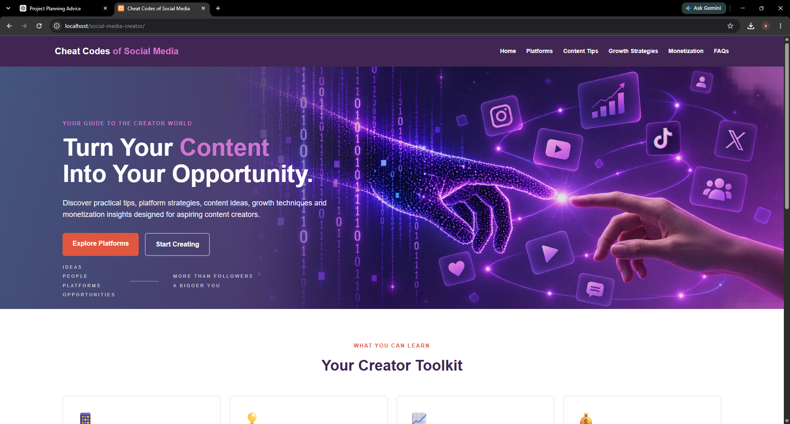
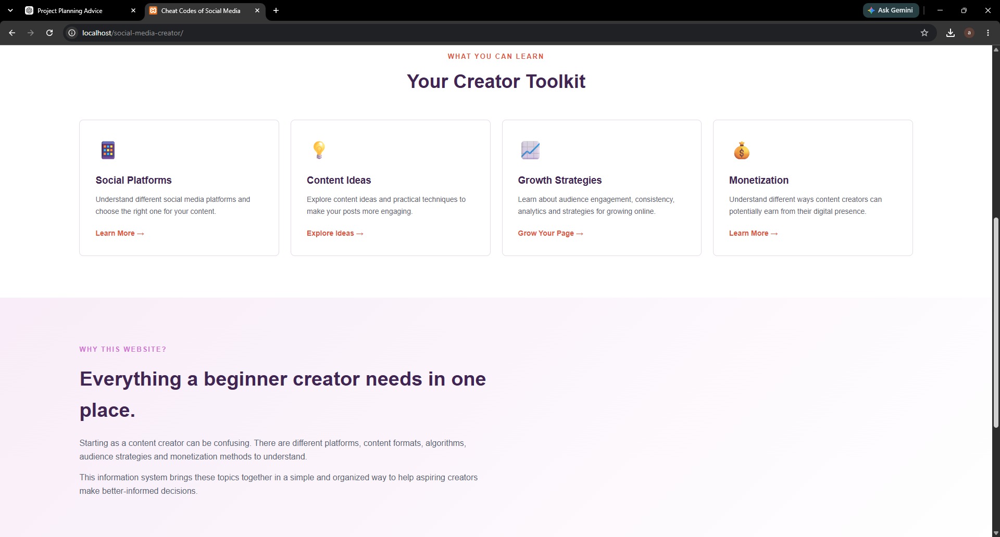
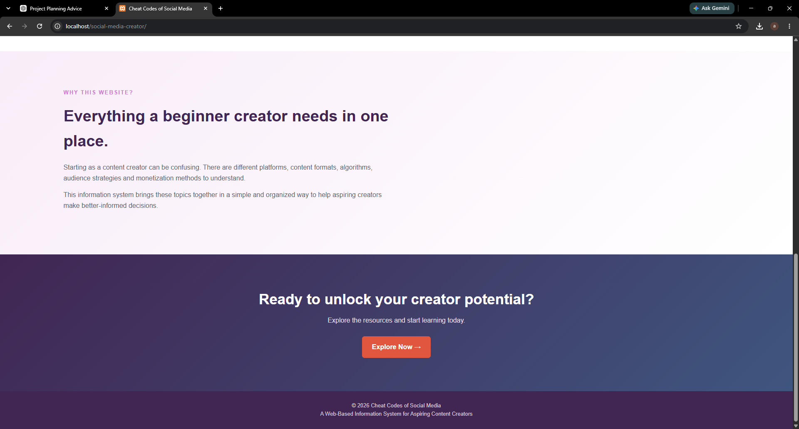
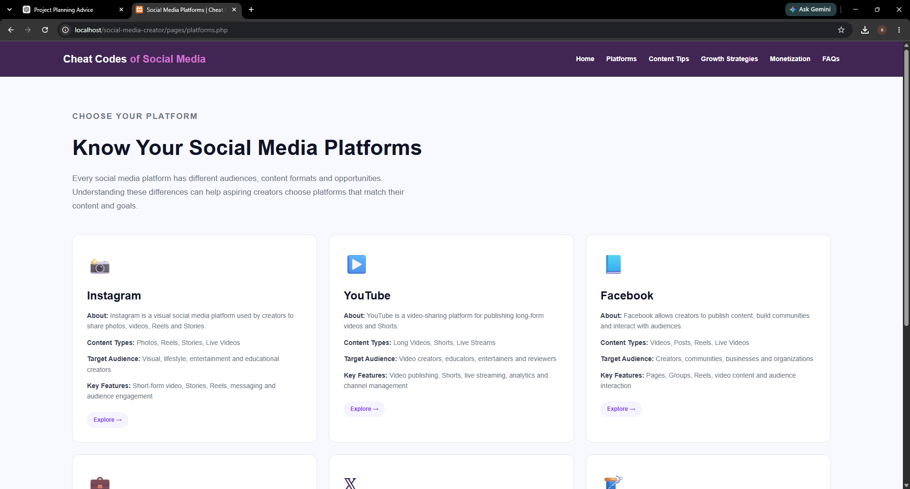
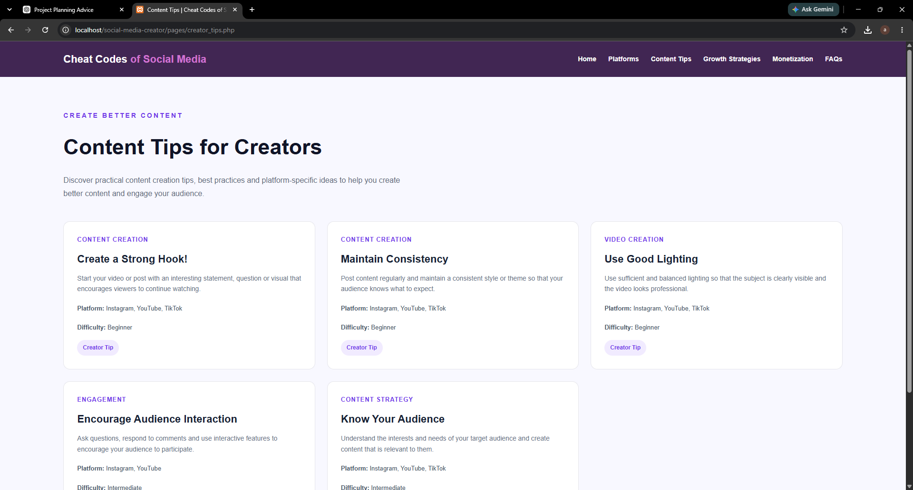
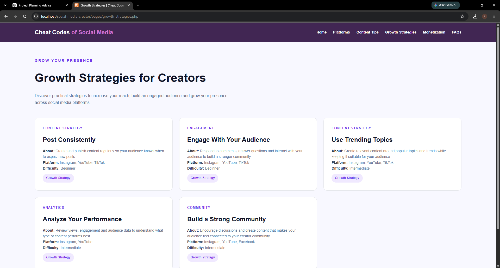
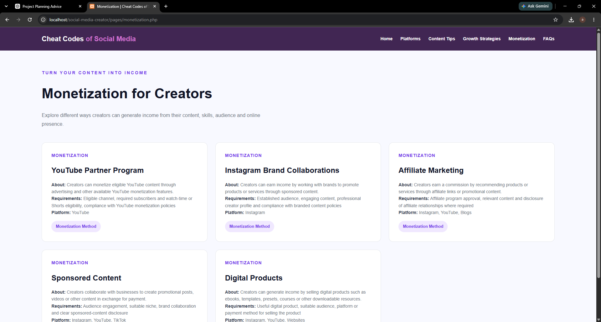
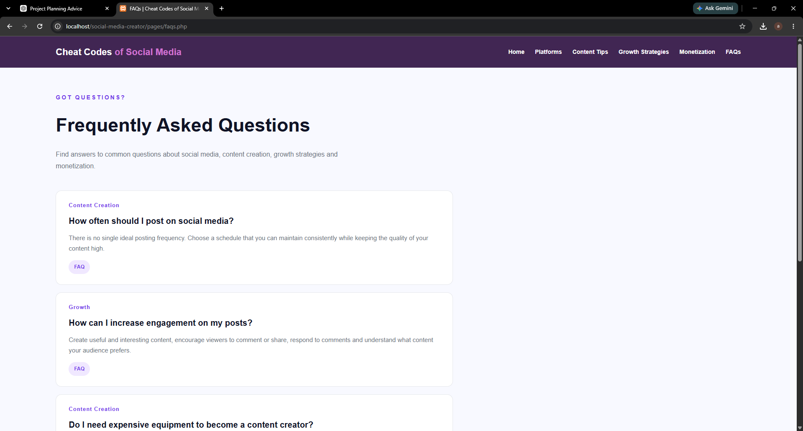

# Cheat Codes of Social Media

## 📌 Project Overview

**Cheat Codes of Social Media** is a web-based information system designed to help aspiring content creators understand different social media platforms and learn how to grow their online presence.

The website provides organised information about content creation, growth strategies, monetization opportunities, frequently asked questions, and online safety guidelines.

## 🎯 Problem Statement

Many aspiring content creators struggle to find reliable and organised information about social media platforms, content creation techniques, audience growth, and monetization opportunities. This project aims to bring these resources together in one user-friendly platform.

## 🎯 Objectives

- To provide information about popular social media platforms.
- To guide users with useful content creation tips.
- To share strategies for growing an online audience.
- To provide information about monetization opportunities.
- To address common questions through an FAQ section.
- To educate users about online safety.

## 💻 Technologies Used

- HTML
- CSS
- JavaScript
- PHP
- MySQL
- XAMPP

## ✨ Features

### 👤 User Module

- **Social Media Platforms:** Provides information about different social media platforms.
- **Content Creation Tips:** Offers tips and guidance for creating engaging content.
- **Growth Strategies:** Shares strategies to improve audience reach and engagement.
- **Monetization Guides:** Provides information about earning opportunities through social media.
- **FAQs:** Answers frequently asked questions.
- **Safety Guides:** Provides guidelines for maintaining safety while using social media.

### 🔐 Admin Module

- Admin Login
- Admin Dashboard
- Manage Social Media Platforms
- Manage Content Creation Tips
- Manage Growth Strategies
- Manage Monetization Guides
- Manage FAQs
- Manage Safety Guides

## 📸 Screenshots

### 1. Homepage







### 2. Social Media Platforms



### 3. Content Creation Tips



### 4. Growth Strategies



### 5. Monetization Guides



### 6. FAQs



## ⚙️ Installation and Setup

Follow these steps to run the project locally:

1. Install [XAMPP](https://www.apachefriends.org/).
2. Start Apache and MySQL from the XAMPP Control Panel.
3. Download or clone this repository.
4. Copy the project folder into the `htdocs` directory of XAMPP.
5. Open phpMyAdmin in your browser.
6. Create a MySQL database.
7. Import the provided SQL file into the database.
8. Update the database connection details in the project configuration file.
9. Open your browser and visit:

   ```text
   http://localhost/project-folder-name/
   ```

## 🚀 Future Enhancements

- Adding more social media platforms.
- Providing updated content creation resources.
- Improving website navigation and user experience.
- Expanding monetization and growth strategy guides.

## 📝 Conclusion

Cheat Codes of Social Media aims to serve as an informative platform for aspiring content creators by bringing together useful resources, strategies, and guidance to help them understand and navigate the world of social media.
